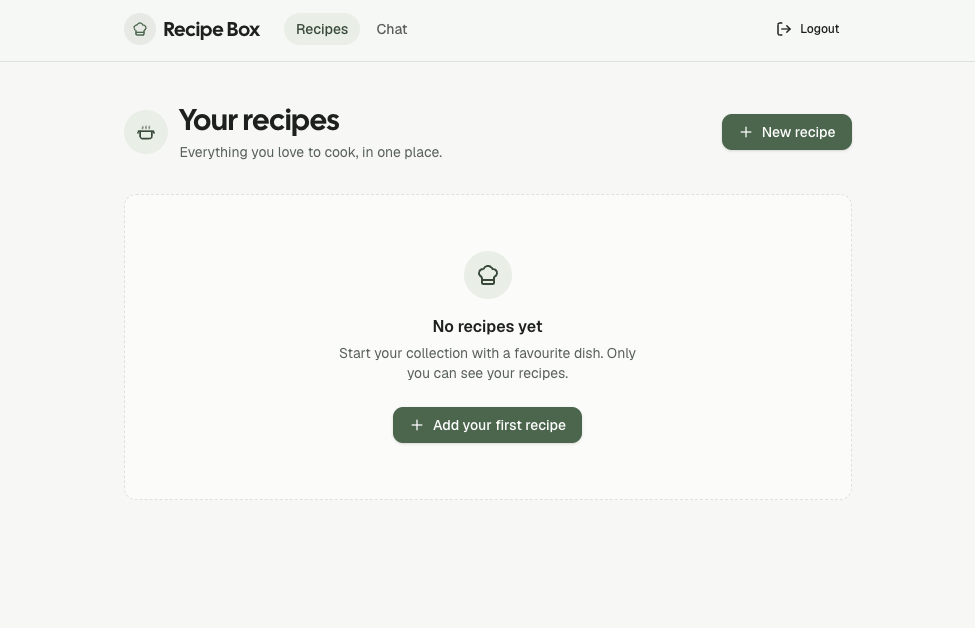
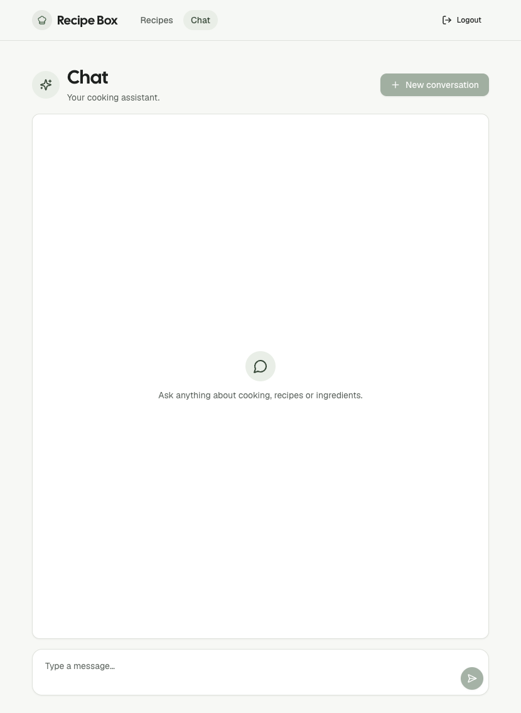

# Recipe Box

A small web app where every signed-in user keeps their own private recipe
collection and can ask an AI cooking assistant for help. Recipes and chat
history belong to one user only and are never visible to anyone else.

Built with Next.js and Supabase, deployed on Vercel.

**Screenshots:** [Recipes page](assets/recipes-page.png) ·
[AI chat page](assets/ai-chat-page.png)

<p>
  <a href="assets/recipes-page.png"></a>
  <a href="assets/ai-chat-page.png"></a>
</p>

## Table of contents

- [Features](#features)
- [Design](#design)
- [Tech stack](#tech-stack)
- [How it works](#how-it-works)
  - [Pages](#pages)
  - [Authentication](#authentication)
  - [Data access](#data-access)
  - [AI chat](#ai-chat)
- [Project structure](#project-structure)
- [Getting started](#getting-started)
  - [Requirements](#requirements)
  - [1. Install](#1-install)
  - [2. Environment variables](#2-environment-variables)
  - [3. Set up the database](#3-set-up-the-database)
  - [4. Run the app](#4-run-the-app)
- [Database](#database)
- [Testing](#testing)
- [Scripts](#scripts)
- [Deployment](#deployment)
- [Development workflow](#development-workflow)
- [Credits](#credits)

## Features

- **Accounts:** sign up with email and password, confirm the email, log in
  and log out (Supabase Auth).
- **Recipes:** create, edit and delete recipes with a title, ingredients and
  instructions. The list shows each recipe with a short ingredient preview.
- **AI cooking chat:** ask questions about cooking, recipes or ingredients.
  Conversations are saved, follow-up questions work, and "New conversation"
  starts a fresh one.
- **Private by design:** signed-out visitors cannot open any recipe or chat
  page, not even through a direct URL, and the database only ever returns a
  user's own rows.
- **Design:** soft sage theme with light and dark mode (follows the system
  setting), works on phone, tablet and desktop.

## Design

A calm, minimal look with one muted green accent, plenty of white space and
soft cards.

**Colors** (soft sage theme, defined as tokens in `app/globals.css`):

| Role | Light mode | Dark mode |
| --- | --- | --- |
| Background | `#F8F9F6` near-white | `#131614` near-black green |
| Cards | `#FFFFFF` white | `#1A1E1B` |
| Text | `#1F2321` deep green-grey | `#EAEDE9` |
| Accent (buttons, links, your chat messages) | `#4F7256` sage green | `#9BC0A0` light sage |
| Soft tint (active nav link, AI chat messages, icon circles) | `#EBF1E9` pale sage | `#29322B` |
| Borders | `#E3E6E0` | `#303632` |
| Delete actions | red | red |

Dark mode follows the system setting.

**Fonts:**
- **Cal Sans** for page titles and the "Recipe Box" logo
- **Geist** for all other text

Both are free Google Fonts, loaded with `next/font` in `app/layout.tsx` and
served by the app itself.

**Icons and details:**
- Icons from [Lucide](https://lucide.dev), plus a hand-drawn cooking pot
  icon.
- Icons next to the page titles (cooking pot, sparkles, notebook) animate
  once when a page opens and again on hover. They stay still when "Reduce
  motion" is turned on.
- Rounded corners (`0.75rem`), soft shadows on cards and buttons.
- Responsive layout for phone, tablet and desktop. On phones, the main
  buttons stay to the right of the page title.

## Tech stack

| Part | Used for |
| --- | --- |
| [Next.js](https://nextjs.org) (App Router) | Pages, server actions, server-side rendering |
| [Supabase](https://supabase.com) | Authentication and Postgres database with Row Level Security |
| [OpenRouter](https://openrouter.ai) | AI model calls for the chat (model set in `lib/ai.ts`) |
| [Tailwind CSS](https://tailwindcss.com) + [shadcn/ui](https://ui.shadcn.com) | Styling and base UI components |
| [Playwright](https://playwright.dev) | End-to-end tests |
| [Vercel](https://vercel.com) | Hosting and deployments |

## How it works

### Pages

| Route | Access | What it does |
| --- | --- | --- |
| `/` | everyone | Redirects: signed in → `/recipes`, signed out → `/auth/login` |
| `/auth/login`, `/auth/sign-up` | signed out | Log in or create an account |
| `/auth/sign-up-success`, `/auth/error` | everyone | Confirmation hint and error messages |
| `/auth/confirm` | everyone | Handles the link in the confirmation email |
| `/recipes` | signed in | List of your recipes |
| `/recipes/new`, `/recipes/[id]/edit` | signed in | Create or edit a recipe |
| `/chat` | signed in | AI cooking assistant (`/chat?c=<id>` opens a saved conversation) |

### Authentication

- Sign-in uses Supabase Auth (email and password) only. The app never stores
  passwords or handles sessions itself.
- `proxy.ts` runs on every request. It refreshes the Supabase session cookie
  and redirects signed-out visitors away from protected pages.
- Protected pages also check the signed-in user on the server
  (`components/signed-in-shell.tsx` → `lib/auth.ts`), so protection does not
  depend on the proxy alone.

### Data access

All database access goes through two central, server-only data handlers:

- `lib/recipes.ts` for the `recipes` table
- `lib/chats.ts` for the `chat_messages` table

Each function verifies the signed-in user before it touches the database.
Pages and components never query Supabase for this data directly, and an
ESLint rule (`eslint.config.mjs`) rejects queries to these tables anywhere
else.

On top of that, every table has **Row Level Security**: policies only allow a
user to read and change rows where `user_id` is their own id. Even a bug in
the app code could not return another user's data.

### AI chat

- The browser sends only the new question to a server action
  (`app/chat/actions.ts`).
- The server loads the conversation's saved messages from Supabase, sends the
  most recent ones plus the question to OpenRouter (`lib/ai.ts`), and saves
  both question and reply.
- All model calls happen on the server. The OpenRouter API key never reaches
  the browser.
- Limits protect against heavy use: questions up to 4,000 characters, the AI
  remembers the last 20 messages of a conversation, and each account can send
  about 20 questions per 10 minutes and 200 per 24 hours. A spending limit on
  the OpenRouter API key is the hard cap on cost.

## Project structure

```
app/                  Pages and routes (App Router)
  auth/               Login, sign-up, confirmation and error pages
  recipes/            Recipe list, create/edit pages, server actions
  chat/               Chat page and its server action
components/           UI components (forms, chat, header, icons)
  ui/                 Base components from shadcn/ui
lib/
  recipes.ts          Central data handler for recipes (server-only)
  chats.ts            Central data handler for chat messages (server-only)
  auth.ts             Server-side sign-in checks
  ai.ts               OpenRouter calls (server-only)
  supabase/           Supabase clients for browser, server and proxy
supabase/migrations/  Database schema, RLS policies and grants
tests/                Playwright end-to-end tests
proxy.ts              Session refresh and redirects on every request
```

## Getting started

### Requirements

- Node.js 22 or newer
- A Supabase project
- An OpenRouter API key (for the chat)

### 1. Install

```bash
npm install
```

### 2. Environment variables

Create a `.env.local` file in the project root. It is git-ignored and must
never be committed.

```bash
# Supabase (project settings → API)
NEXT_PUBLIC_SUPABASE_URL=your-project-url
NEXT_PUBLIC_SUPABASE_PUBLISHABLE_KEY=your-publishable-key

# OpenRouter (server-only, never add a NEXT_PUBLIC_ prefix)
OPENROUTER_API_KEY=your-openrouter-key

# Confirmed test user for the Playwright tests
E2E_TEST_EMAIL=test-user-email
E2E_TEST_PASSWORD=test-user-password
```

The app only needs the Supabase project URL and the **publishable** key.
Security comes from authentication and Row Level Security. Do not add a
Supabase secret or service role key.

### 3. Set up the database

The schema lives in migration files and is applied with the Supabase CLI
(included as a dev dependency):

```bash
npx supabase login
npx supabase link --project-ref <your-project-ref>
npx supabase db push
```

This creates the `recipes` and `chat_messages` tables with their RLS
policies.

### 4. Run the app

```bash
npm run dev
```

Open [http://localhost:3000](http://localhost:3000). Local development and
the deployed app use the same Supabase project, so data created locally also
appears on the deployed app.

## Database

| Table | Columns |
| --- | --- |
| `recipes` | `id`, `user_id`, `title`, `ingredients`, `instructions`, `created_at` |
| `chat_messages` | `id`, `user_id`, `conversation_id`, `role`, `content`, `created_at` |

- Ingredients and instructions are plain text.
- A conversation is the set of `chat_messages` rows that share a
  `conversation_id`; there is no separate conversations table.
- `id`, `user_id` and `created_at` are filled in by the database by default
  (`user_id` from the signed-in user). For `chat_messages`, users can only
  set `conversation_id`, `role` and `content`; the other columns always come
  from the database.
- RLS lets users read, create and delete only their own rows. Recipes can
  also be updated; chat messages cannot be edited.
- Every schema change is a new file in `supabase/migrations/`. The schema is
  never changed only in the Supabase dashboard.

## Testing

```bash
npm run test:e2e
```

- Playwright starts the dev server automatically if it is not already running
  on `localhost:3000`.
- Tests log in with the confirmed test user from `E2E_TEST_EMAIL` and
  `E2E_TEST_PASSWORD`. They never sign up new users or read emails, and they
  are skipped if these variables are missing.
- Each test deletes the recipes and conversations it created, so the test
  account is empty again afterwards. Tests run one at a time because they
  share this account.
- Chat tests never call OpenRouter. On the local dev server only, a test
  cookie switches the model call to fixed test replies
  (`lib/ai-test-substitute.ts`); this never works in a production build.

## Scripts

| Command | What it does |
| --- | --- |
| `npm run dev` | Start the dev server on `localhost:3000` |
| `npm run build` | Create a production build |
| `npm run start` | Run the production build |
| `npm run lint` | Run ESLint (includes the data-access rules) |
| `npm run test:e2e` | Run the Playwright tests |

## Deployment

The app is deployed on Vercel and connected to the GitHub repository:

- Every pull request gets a preview deployment.
- Merging into `main` deploys to production.

Set the same environment variables in the Vercel project settings
(`NEXT_PUBLIC_SUPABASE_URL`, `NEXT_PUBLIC_SUPABASE_PUBLISHABLE_KEY`,
`OPENROUTER_API_KEY`). Keep `OPENROUTER_API_KEY` server-only. In Supabase
Auth, add the Vercel URL to the allowed redirect URLs so confirmation emails
link back to the deployed app.

## Development workflow

- One feature branch per build step, merged into `main` through a pull
  request.
- A Playwright happy-path test is added after each feature.
- Changes are reviewed with the `ai-code-reviewer` agent; findings and fixes
  are recorded in [`REFLECTION.md`](REFLECTION.md).
- `/security-scan` runs the Supabase, Next.js and Vercel security scanners
  (`.claude/agents/`) and merges their findings into one report.
- Project rules for Claude Code are in [`CLAUDE.md`](CLAUDE.md).

## Credits

- Fonts: [Geist](https://vercel.com/font) and
  [Cal Sans](https://fonts.google.com/specimen/Cal+Sans), both under the SIL
  Open Font License.
- Icons: [Lucide](https://lucide.dev) (ISC license).
